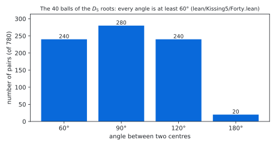
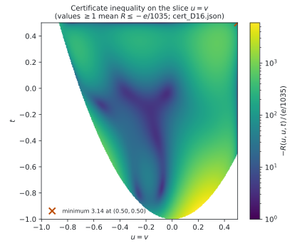
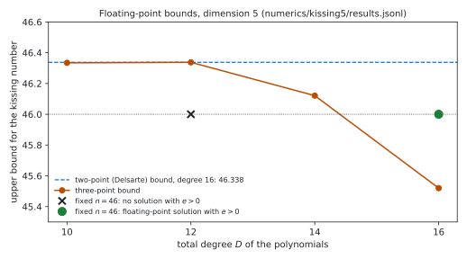

# Bounds for the kissing number in dimension 5: a Lean 4 formalisation of 40 ≤ κ(5) ≤ 44

[](https://doi.org/10.5281/zenodo.24145123)

Status: **Lean 4 formalisation, not peer reviewed.** Version 2, prepared 2026-11-25 (version 1, 2026-11-11: the bounds
40 and 45). **Produced by AI models** under the direction of the repository owner; see
[`AI_DISCLOSURE.md`](AI_DISCLOSURE.md).

> [!IMPORTANT]
> This repository is a public, timestamped, AI-produced **warrant** for a Lean 4 proof that the kissing number in
> dimension 5 is at least 40 and at most 44: a machine-checked argument that no human has yet digested.
> - **Both bounds are known, and 44 is not the best known upper bound.** Mittelmann and Vallentin (2010) obtained 44
>   from a high-precision floating-point computation. Tomar (2026, preprint) proves $`\kappa(5) \le 43`$ with an exact
>   certificate; the preprint's Lean proofs assume the positivity of zonal kernels built from data files
>   ([related work](#upstream-code-and-related-work)).
> - **What is here:** an exact rational three-point certificate for 44, and a Lean proof of 44 without such an
>   assumption. The positivity theorem it needs is proved in Lean, and the theorem depends only on Lean's standard
>   axioms.
> - We do not regard this formal argument as settled until it has been checked independently.
>
> Independent verification and human-readable expositions are welcome, and credit for a human-readable proof belongs
> to whoever writes one. To refer to the computational result, please cite the archived repository
> ([10.5281/zenodo.24145123](https://doi.org/10.5281/zenodo.24145123)). Questions, checks and corrections:
> [GitHub issues](https://github.com/alejandrozarco/kissing-number-5/issues).

Archived on Zenodo: [10.5281/zenodo.24145123](https://doi.org/10.5281/zenodo.24145123) (all versions).
Cite with `CITATION.cff`.

The kissing number $`\kappa(d)`$ is the largest number of non-overlapping unit balls in $`\mathbb{R}^d`$ that touch a
common unit ball. Its value in dimension 5 is not known; the best known upper bound is 43 (Tomar, 2026, preprint).
The Lean kernel checks, in two theorems with the same definitions (see below),

```math
40 \le \kappa(5) \le 44 .
```

- **Upper bound 44** (added in version 2): stated in `lean/Kissing5/Statement44.lean`, proved in
  `lean/Kissing5/Solution44.lean`. It uses an exact three-point semidefinite certificate in the sense of Bachoc and
  Vallentin for 45 points, of total degree 32, checked by `decide +kernel`, and a Lean proof of the Bachoc–Vallentin
  positivity theorem on the sphere $`S^4`$ for degrees up to 16.
- **Lower bound 40** and the weaker upper bound 45 (version 1): stated in `lean/Kissing5/Statement.lean`, proved in
  `lean/Kissing5/Solution.lean`. The lower bound uses the 40 roots of $`D_5`$, with integer coordinates.

The two statement files use the same definitions, word for word, in two namespaces (`Kissing5` and `Kissing5.K44`),
so that the proof of 44 does not depend on the certificate of 45.

## The statement

```lean
abbrev E (d : ℕ) := EuclideanSpace ℝ (Fin d)

def IsKissing {d : ℕ} (S : Set (E d)) : Prop :=
  (∀ x ∈ S, ‖x‖ = 2) ∧ ∀ x ∈ S, ∀ y ∈ S, x ≠ y → 2 ≤ dist x y

noncomputable def kissingNumber (d : ℕ) : ℕ∞ :=
  ⨆ (S : Set (E d)) (_ : IsKissing S), S.encard

-- lean/Kissing5/Statement44.lean (namespace Kissing5.K44)
theorem encard_le_fortyFour_of_isKissing (S : Set (E 5)) (hS : IsKissing S) : S.encard ≤ 44
theorem kissingNumber_five_le_fortyFour : kissingNumber 5 ≤ 44

-- lean/Kissing5/Statement.lean (namespace Kissing5)
theorem exists_isKissing_encard_eq_forty : ∃ S : Set (E 5), IsKissing S ∧ S.encard = 40
theorem encard_le_fortyFive_of_isKissing (S : Set (E 5)) (hS : IsKissing S) : S.encard ≤ 45
theorem kissingNumber_five_bounds : 40 ≤ kissingNumber 5 ∧ kissingNumber 5 ≤ 45
```

`IsKissing S` says that the points of `S` are centres of unit balls that touch the unit ball at the origin (distance
2) and do not overlap each other (pairwise distance at least 2). Sets may be infinite; sizes are counted in `ℕ∞`.
Three further theorems of `Statement.lean` test the definition:
- two opposite balls form an arrangement;
- two balls $`30^\circ`$ apart do not;
- a ball at distance 3 does not.

The definitions are those of [kissing-number-3](https://github.com/alejandrozarco/kissing-number-3) and
[kissing-number-4](https://github.com/alejandrozarco/kissing-number-4) with $`d = 5`$.
[`lean/STATEMENT44.md`](lean/STATEMENT44.md) and [`lean/STATEMENT5.md`](lean/STATEMENT5.md) explain every line.

Checks recorded in [`verification44/`](verification44/) (bound 44) and [`verification/`](verification/) (version 1):
- **Comparator:** the theorems of `lean/comparator44.json` (and of `lean/comparator5.json`) have the statements of the
  statement files, use only the axioms `propext`, `Quot.sound`, `Classical.choice`, and are accepted by the Lean
  kernel.
- **Axioms:** `#print axioms` reports `[propext, Classical.choice, Quot.sound]` for all of them.
- **Second kernel:** their export is accepted by nanoda, an independent type checker for Lean 4 written in Rust. A
  copy with one changed number is rejected.
- **Clean build:** the modules each proof uses, compiled one at a time from a fresh copy, with wall time and peak
  memory (summary below).

The files contain no `sorry` outside the statement files and no `native_decide`.

## The argument for 44

Any arrangement with more than 44 balls contains 45. Halving their centres gives unit vectors
$`x_1, \dots, x_{45}`$ in $`\mathbb{R}^5`$ with $`\langle x_i, x_j \rangle \le 1/2`$ for $`i \ne j`$. For three unit
vectors write $`(u, v, t)`$ for their pairwise inner products, and let $`\Delta`$ be the set of such triples with
$`u, v, t \le 1/2`$. The certificate consists of positive definite matrices $`F_0, \dots, F_{16}`$ of sizes 17 to 1.
With the Bachoc–Vallentin matrices $`S_k`$ of $`S^4`$ and

```math
s(u,v,t) = \sum_{k=0}^{16} \langle F_k, S_k(u,v,t) \rangle ,
\qquad
R(u,v,t) = 43\, s(u,v,t) + s(u,u,1) + s(v,v,1) + s(t,t,1) + \frac{1}{44}\, s(1,1,1),
```

it contains a sum-of-squares identity showing

```math
R(u,v,t) \le -\frac{e}{990}, \qquad e = 2^{-25}, \quad \text{on } \Delta .
```

Summing over all ordered triples of distinct points and using the positivity of $`\sum_{i,j,l} S_k`$ gives
$`e \le 0`$, a contradiction. The polynomials have total degree 32. The sum-of-squares part uses the multipliers
$`1`$, $`1/2-u`$, $`1/2-v`$, $`1/2-t`$ and the Gram determinant $`1 + 2uvt - u^2 - v^2 - t^2`$. Their Gram matrices
have sizes 969, 816 (three times) and 680. All entries are rationals; in Lean they are integers over the common
denominator $`\Lambda = \Lambda_0 \cdot 2^{72}`$.

This certificate is about a million times tighter than the one for 45 ($`e = 1/32`$ there), and much larger:
- **Numerics.** The floating-point optimum has $`e \approx 7 \cdot 10^{-8}`$, and the Gram matrices have condition
  numbers above $`10^{16}`$, beyond double precision. It was found with SDPA-GMP at 160 bits, on data computed at 256 bits and
  written with 60 significant digits (`numerics/kissing5/sdpa5.py`, `HP=1`).
- **Rounding.** `numerics/kissing5/d32/round_hp.py` rounds the solution to exact rationals that satisfy the identity
  coefficient by coefficient. It certifies positive definiteness by exact $`LDL^T`$ for the $`F_k`$ and by
  congruence (a matrix $`W`$ with $`W B W^T`$ strictly diagonally dominant) for the Gram matrices.
- **Independent check.** `numerics/kissing5/check_big_k5.py`, sharing no code with the rounding, checks the same
  certificate: the polynomial identity exactly, and positive definiteness by an Arb-certified congruence
  (`numerics/kissing5/d32/k64/check_big.log`).

How Lean checks it:
- **No positive-definiteness test in Lean.** Each Gram matrix is written as an explicit sum of squares,
  $`\sum_q d_q (\sum_c l_{qc} z_c)^2 + \sum_i [\delta_i z_i^2 + \sum_{j > i} |\Delta_{ij}| (z_i \pm z_j)^2]`$ with
  $`d_q, \delta_i \ge 0`$. This is an exact $`LDL^T`$ plus a diagonally dominant remainder, so it is nonnegative by
  construction (`lean/Kissing5/Tree/`).
- **Kronecker check of the identity.** The identity is checked by Kronecker substitution, as in version 1. A row of a
  Gram matrix is a balanced tree of terms whose statistics (ℓ¹ norm, degrees, Kronecker value) the kernel computes in
  core Lean, without Mathlib: 448 chunk modules, each needing at most 2.2 GiB. Their sums are combined in
  `Cert44/S*/Sum.lean`, and soundness is proved once in `lean/Kissing5/Tree/Sound.lean`.
- **Positivity on $`S^4`$ up to degree 16.** The addition identities behind it are checked by Kronecker substitution
  too (`lean/Kissing5/G4/`), because `ring` needs too much memory beyond degree 8.

| Lean module | content |
|---|---|
| `Kissing5/Statement44.lean`, `Kissing5/Solution44.lean` | the statement of the bound 44 and its proof from the certificate |
| `Kissing5/Tree/Core.lean`, `Tree/Sound.lean` | core-only tree-shaped row checks and their soundness |
| `Kissing5/Tree/Cert.lean` | the checker `CertK5T` with SOS blocks as explicit sums of squares, and its soundness theorem `no_config5T` |
| `Kissing5/Tree/FPart.lean` | the $`F`$-part of the identity in balanced sums, so that its kernel check stays small at degree 32 |
| `Kissing5/G4/` | addition identities by Kronecker substitution; Gegenbauer kernels of $`\mathbb{R}^3`$, $`\mathbb{R}^4`$ positive semidefinite and Bachoc–Vallentin positivity on $`S^4`$ for degrees up to 16 |
| `Kissing5/Cert44/` (generated, not stored) | the certificate data (`Data.lean`), the $`F`$-block checks (`ChkF*.lean`), the row-chunk checks (`S*/Q*.lean`, `S*/P*.lean`), their sums (`S*/Sum.lean`) and the composition (`Check.lean`) |

The bound 44 reuses `Kissing5/Kernel.lean`, `Kissing5/Bound.lean`, the degree-independent lemmas of
`Kissing5/Positivity.lean` and the dimension-3 checker `lean/Kissing/CertK.lean`; version 1's modules are described
below.

### The generated certificate modules

`lean/Kissing5/Cert44/` has 472 files, about 516 MB. That is too large for this repository, so the files are not
stored. `lean/regen44.sh` rebuilds them from the stored inputs and checks every file against
`lean/gen/cert44.sha256`, the sha256 list of the files that were compiled for `verification44/`. The inputs are:
- the exact certificate `numerics/kissing5/d32/k64/cert.json.xz`;
- the generator `lean/gen/gen_t5.py`, with `lean/gen/cert3_util.py`, `lean/gen/emit_k5.py` and
  `numerics/kissing5/d32/hp_blocks.py`;
- `numerics/kissing5/d32/t5/lam.json`, the cached estimates of the smallest eigenvalues that set the shifts of the
  $`LDL^T`$ packing. Those of the Gram matrices come from a fixed-point $`LDL^T`$ with inverse iteration, and those of
  the $`F_k`$ from a double-precision eigenvalue routine; caching them makes the regeneration independent of the
  machine. Everything built from them is then checked exactly, by the generator and again by Lean.

<details><summary>Version 1: the argument for 45 and its modules</summary>

### The argument for 45 (version 1)

Any arrangement with more than 45 balls contains 46. Halving their centres gives unit vectors
$`x_1, \dots, x_{46}`$ in $`\mathbb{R}^5`$ with $`\langle x_i, x_j \rangle \le 1/2`$ for $`i \ne j`$. For three unit
vectors write $`(u, v, t)`$ for their pairwise inner products, and let $`\Delta`$ be the set of such triples with
$`u, v, t \le 1/2`$. The certificate consists of positive definite matrices $`F_0, \dots, F_8`$ of sizes 9 to 1. With
the Bachoc–Vallentin matrices $`S_k`$ of $`S^4`$ and

```math
s(u,v,t) = \sum_{k=0}^{8} \langle F_k, S_k(u,v,t) \rangle ,
\qquad
R(u,v,t) = 44\, s(u,v,t) + s(u,u,1) + s(v,v,1) + s(t,t,1) + \frac{1}{45}\, s(1,1,1),
```

it contains a sum-of-squares identity showing

```math
R(u,v,t) \le -\frac{1}{32 \cdot 1035} \quad \text{on } \Delta .
```

Summing over all ordered triples of distinct points and using the positivity of $`\sum_{i,j,l} S_k`$ gives
$`1/32 \le 0`$, a contradiction. The polynomials have total degree 16. The sum-of-squares part uses the multipliers
$`1`$, $`1/2-u`$, $`1/2-v`$, $`1/2-t`$ and the Gram determinant $`1 + 2uvt - u^2 - v^2 - t^2`$. Their Gram matrices
have sizes 165, 120 (three times) and 84. All entries are rationals with a common denominator.

The positivity of $`\sum_{i,j,l} S_k(\langle x_i,x_j\rangle, \langle x_i,x_l\rangle, \langle x_j,x_l\rangle)`$ for
unit vectors of $`\mathbb{R}^5`$ is proved in `lean/Kissing5/Positivity.lean` for $`k \le 8`$. In an orthonormal
frame of the complement of $`x_i`$, the kernel becomes the solid Gegenbauer kernel of $`\mathbb{R}^4`$. That kernel is
positive semidefinite by induction on the dimension from $`\mathbb{R}^2`$ (`lean/Kissing5/Psd.lean`). The induction
uses one addition identity per degree and dimension (`lean/Kissing5/Addition*.lean`, generated by
`lean/gen/gen_addition5.py`).

| Lean module | content |
|---|---|
| `Kissing5/Kernel.lean` | the kernels of $`S^4`$, the Gram determinant in $`\mathbb{R}^5`$, the three-point identity |
| `Kissing5/Addition*.lean`, `Kissing5/Psd.lean` | addition identities and positive semidefiniteness of the Gegenbauer kernels of $`\mathbb{R}^3`$ and $`\mathbb{R}^4`$, degrees 0 to 8 |
| `Kissing5/Positivity.lean` | Bachoc–Vallentin positivity on $`S^4`$, degrees 0 to 8 |
| `Kissing5/Bound.lean` | the three-point bound in $`\mathbb{R}^5`$, with the inner products restricted by an arbitrary condition |
| `Kissing5/CertK.lean` | the exact certificate checker for $`\Delta`$ and its soundness theorem |
| `Kissing5/Chunk.lean` | lemmas that split the kernel checks of large blocks into chunks of rows |
| `Kissing5/Cert/` | the certificate data and its `decide +kernel` checks (one module per $`F`$-block; 4 to 8 rows per module for the sum-of-squares blocks) |
| `Kissing5/Forty.lean` | the 40 points: integer coordinates scaled by $`\sqrt 2`$, norm exactly 2, pairwise distance at least 2 |
| `Kissing5/Solution.lean` | the statements of `Kissing5/Statement.lean`, with proofs |

`Kissing5` reuses code from earlier developments:
- the dimension-independent certificate format and checker of the dimension-3 development (`lean/Kissing/`,
  published as [kissing-number-3](https://github.com/alejandrozarco/kissing-number-3));
- the Gegenbauer kernels and the induction step of the dimension-8 development (`lean/Kissing8/Kernel.lean`, published
  as [kissing-number-8](https://github.com/alejandrozarco/kissing-number-8)).

The Lean package here also contains the dimension-3, -4 and -8 developments, which share its Lake configuration. Their
verification records are in their own repositories; `verification/` holds the records for the bounds 40 and 45.

The certificate was found in floating point with a symmetry-reduced formulation (`numerics/kissing5/k5.py`,
`sym.py`). It was rounded to exact rationals (`numerics/kissing5/round_k5.py`). Before the Lean check, an independent
script checked it in exact arithmetic (`numerics/kissing5/check_cert_k5.py`). The same script rejects ten tampered
versions (`check_controls_k5.py`).

</details>

## Figures

Regenerate with `python3 figures/make_figures.py` (matplotlib 3.9.4, numpy); every figure is computed from repository
files only. They are those of version 1.

<picture>
  <source media="(prefers-color-scheme: dark)" srcset="figures/angles_dark.svg">
  
</picture>

The 780 angles between the 40 centres of the lower bound (`lean/Kissing5/Forty.lean`), seen from the origin.
Two balls touching the central ball overlap exactly when their angle is below $`60^\circ`$; here 240 pairs touch.

<picture>
  <source media="(prefers-color-scheme: dark)" srcset="figures/certificate_dark.svg">
  
</picture>

The version-1 certificate inequality $`R \le -e/1035`$ with $`e = 1/32`$ (46 points, degree 16), evaluated in
floating point from `cert_D16.json` on the slice $`u = v`$ of the region $`\Delta`$ (white: triples that are not
inner products of unit vectors). The Lean check covers all of $`\Delta`$ exactly.

<picture>
  <source media="(prefers-color-scheme: dark)" srcset="figures/bounds_dark.svg">
  
</picture>

Floating-point values from `numerics/kissing5/results.jsonl` (not certified), up to degree 16:
- the two-point (Delsarte) bound is 46.338;
- the three-point bound computed here drops below 46 only at degree 16 (45.52).

For $`n = 45`$, the fixed-$`n`$ margin is negative at degree 24 ($`e = -4.8 \cdot 10^{-9}`$, SDPA-GMP log
`numerics/kissing5/sdpa/s24.log`) and positive at degree 32 ($`e \approx 7.0 \cdot 10^{-8}`$;
`numerics/kissing5/d32/`).

## Contents

| path | content |
|---|---|
| `lean/` | the Lean package: statements, proofs, certificate modules of version 1, generators (`gen/`), `regen.sh`, `regen44.sh`, Comparator configs, build and second-kernel scripts |
| `lean/STATEMENT44.md`, `lean/STATEMENT5.md` | the statements in plain English |
| `numerics/kissing5/` | SDP formulations for $`S^4`$, solutions, exact rounding, exact checkers, the certificates `cert_D16.json` (45) and `d32/k64/cert.json.xz` (44) |
| `numerics/kissing3/` | the dimension-3 code that `numerics/kissing5/` builds on (from kissing-number-3) |
| `verification44/`, `verification/` | records of the clean builds, Comparator, axioms, the second kernel and the upstream-text scans, for 44 and for version 1 |
| `figures/` | the figures and `make_figures.py` |
| `formalization.yaml` | metadata (mathlib-initiative format v0.4) |
| `AI_DISCLOSURE.md` | how AI models were used, what is checked and what is trusted |
| `LICENSE`, `CITATION.cff` | licence (Apache-2.0) and citation metadata |
| `MANIFEST.sha256` | sha256 of every file |

## Reproduce

Lean (toolchain `leanprover/lean4:v4.34.1`, Mathlib `d13f23b`, both pinned). The bound 44:

```sh
cd lean
./regen.sh                    # regenerates ThomsonGen/*.lean from upstream; checks the eight imported ones by sha256
./regen44.sh                  # regenerates Kissing5/Cert44/ (about 25 min, 1.5 GB; python3 with gmpy2 and numpy, xz)
lake exe cache get
bash scripts/build_test.sh build_test44.tsv "Kissing5.Statement44 Kissing5.Solution44 Kissing5.Axioms44"
```

`build_test.sh` compiles every module one at a time and then runs the axiom check of `Kissing5/Axioms44.lean`: 504
modules. The 502 of the proof (`Kissing5.Solution44` and its imports) took 8.7 h on the machine of
`verification44/`. The largest needs 8.5 GiB (an upstream-derived module),
the composition `Kissing5.Cert44.Check` 8.4 GiB, and the 448 chunk modules at most 2.2 GiB each. With `Kissing5.Statement
Kissing5.Solution Kissing5.Axioms` as roots, the same script checks version 1 (no `regen44.sh` needed).

`lake build Kissing5` builds every module of `lean/Kissing5/`, so it needs `regen44.sh` first and may compile several
large modules in parallel.

- `lean/scripts/run_comparator.sh comparator44.json` (or `comparator5.json`) runs
  [Comparator](https://github.com/leanprover/comparator).
- `lean/scripts/second-kernel.sh comparator44.json` (or `comparator5.json`) runs
  [nanoda](https://github.com/ammkrn/nanoda_lib) and the negative control.

Without prebuilt tools, both scripts fetch and build them at the revisions pinned in `lean/scripts/tools.sh`. That
file also records the sha256 of the binaries used for `verification44/` and `verification/`.

Certificate for 44 (Python 3, `python-flint`, `mpmath`, `numpy`; SDPA-GMP only to re-solve):

```sh
cd numerics/kissing5
xz -dk d32/k64/cert.json.xz
python3 check_big_k5.py d32/k64/cert.json                    # independent exact check (about 25 min, 1.4 GB)
HP=1 python3 sdpa5.py write 32 45 sdpa/k5_D32_n45_hp.dat-s   # the SDP in SDPA format, 60-digit data (140 MB)
xz -dk d32/hp072.out.xz                                       # the SDPA-GMP solution that was rounded
python3 d32/round_hp.py sdpa/k5_D32_n45_hp.dat-s d32/hp072.out cert.json 64 1/33554432   # re-round (about 25 min)
```

On the laptop (macOS arm64; Python 3.9.6, numpy 1.26.4, mpmath 1.3.0, python-flint 0.6.0) the last three steps
reproduced the SDP file (sha256 in `d32/k5_D32_n45_hp.dat-s.sha256`) and the certificate byte for byte, in 22 min at
1.3 GB (`d32/k64/reround_release.log`). The symmetry-adapted bases in `sdpa5.py` come from a floating-point SVD
(numpy), so on another machine the SDP file can differ in its last digits; the stored solution may then round to a
different certificate, or fail to round. Neither affects the proof: the Lean files are generated from the stored
certificate, and the Lean kernel checks it.

Version 1's certificate: see `numerics/kissing5/README.md`.

## Clean build (bound 44)

The modules reachable from `Kissing5.Solution44`, each compiled one at a time (`lean/scripts/build_test.sh`, `lean -j1`) from a fresh copy of `lean/` after `regen.sh` and `lake exe cache get`, on Linux x86_64 (`verification44/build_test44.tsv`; per-module table there). Wall time includes loading Mathlib for each module. Memory in GiB ($`2^{30}`$ bytes).

502 modules, total 8.7 h; largest peak 8.54 GiB (`ThomsonGen.M2`).

| modules | count | wall (h) | largest peak (GiB) |
|---|---:|---:|---:|
| `ThomsonGen.*` (regenerated upstream modules) | 8 | 0.13 | 8.54 |
| other modules (`Kissing5.*`, `Kissing.*`, `Kissing8.Kernel`) | 22 | 0.11 | 6.87 |
| `Kissing5.Cert44.S*.P*`, `S*.Q*` (row chunks, core Lean only) | 448 | 6.96 | 2.21 |
| `Kissing5.Cert44.S*.Sum` | 5 | 1.31 | 1.17 |
| `Kissing5.Cert44.Data` | 1 | 0.04 | 6.72 |
| `Kissing5.Cert44.ChkF*` | 17 | 0.15 | 7.58 |
| `Kissing5.Cert44.Check` | 1 | 0.01 | 8.37 |

### Second copy

The same closure plus `Kissing5.Statement44` and `Kissing5.Axioms44`, each built with `lake build <module>` one at a time in the copy used for Comparator and the second kernel (`verification44/prebuild44.tsv`).

504 modules, total 9.1 h; largest peak 8.62 GiB (`ThomsonGen.M2`).

| modules | count | wall (h) | largest peak (GiB) |
|---|---:|---:|---:|
| other modules (`Kissing5.*`, `Kissing.*`, `Kissing8.Kernel`) | 24 | 0.27 | 6.87 |
| `ThomsonGen.*` (regenerated upstream modules) | 8 | 0.13 | 8.62 |
| `Kissing5.Cert44.S*.P*`, `S*.Q*` (row chunks, core Lean only) | 448 | 7.14 | 2.21 |
| `Kissing5.Cert44.S*.Sum` | 5 | 1.20 | 2.97 |
| `Kissing5.Cert44.Data` | 1 | 0.06 | 6.73 |
| `Kissing5.Cert44.ChkF*` | 17 | 0.25 | 8.11 |
| `Kissing5.Cert44.Check` | 1 | 0.01 | 8.38 |

## Upstream code and related work

- **Coulomb Thomson problem (upstream).** The three-point machinery (the three-point identity, the integer
  certificate format with the Kronecker check) is from the Lean formalisation of the Coulomb Thomson problem,
  [huwngtran/thomson-n7-lean](https://github.com/huwngtran/thomson-n7-lean) at commit `25f2fa5`.
  - That repository has no licence file, so its code is not stored here. `lean/regen.sh` downloads the pinned file,
    regenerates the upstream-derived `ThomsonGen/` modules, and checks the eight that are imported against
    `lean/ThomsonGen/scripts/generated.sha256`.
  - Declarations adapted from it name their upstream source in a comment after the imports.
    `lean/ThomsonGen/scripts/scan_upstream.py` checks this (`verification44/scan_upstream.txt`).
  - Upstream proves Bachoc–Vallentin positivity on $`S^2`$; the $`S^4`$ version here is new code following the same
    plan.
- **Our own tools.** The splitter `split.py`, the scanner, `lean/gen/cert3_util.py`, `numerics/kissing3/polyk.py` and
  the second-kernel script are adapted from [alejandrozarco/thomson-n7-log](https://github.com/alejandrozarco/thomson-n7-log).
- **Literature.**
  - C. Bachoc and F. Vallentin, *New upper bounds for kissing numbers from semidefinite programming*, J. Amer. Math.
    Soc. 21 (2008), 909–924: the three-point method and the bound $`\kappa(5) \le 45`$.
  - H. D. Mittelmann and F. Vallentin, *High-accuracy semidefinite programming bounds for kissing numbers*,
    Experiment. Math. 19 (2010), 175–179: $`\kappa(5) \le 44`$, from a high-precision floating-point computation.
  - F. C. Machado and F. M. de Oliveira Filho, *Improving the semidefinite programming bound for the kissing number by
    exploiting polynomial symmetry*, Experiment. Math. 27 (2018): the three-point bound with the symmetry reduction
    used here; 44.981 in dimension 5 at the degree used here.
  - A. M. Odlyzko and N. J. A. Sloane, *New bounds on the number of unit spheres that can touch a unit sphere in n
    dimensions*, J. Combin. Theory Ser. A 26 (1979): the linear programming bound 46.
  - T. S. Tomar, *The kissing numbers in dimensions five, six and seven are at most 43, 76 and 132*, preprint,
    Zenodo [10.5281/zenodo.23638108](https://doi.org/10.5281/zenodo.23638108) (version 1, 2026-10-27, for dimension
    5; version 3, 2026-11-12): $`\kappa(5) \le 43`$ from an exact rational solution of the second level of the
    Lasserre hierarchy of de Laat, Leijenhorst and de Muinck Keizer, checked with their verification program. Its Lean
    theorems (§9) are conditional on a hypothesis `ZonalPSD`, the positivity of the zonal kernels built from the
    zonal-polynomial files; the paper states that the correctness of these files is not formalised, and checks the
    hypothesis numerically. One version decides the finite checks by compiled code (`native_decide`); in the other,
    the Lean kernel does every check and the theorems depend only on the standard axioms, with the hypothesis.
  - SDPA-GMP: M. Nakata, *A numerical evaluation of highly accurate multiple-precision arithmetic version of
    semidefinite programming solver: SDPA-GMP, -QD and -DD*, IEEE CACSD 2010.
- **Related formal and exact work.** Found on 2026-10-02, 2026-11-11 and 2026-11-25 (Tomar's preprint above was
  pointed out to us on 2026-11-25):
  - lattice kissing numbers in Lean (TauCetiProject/TauCeti);
  - asymptotic bounds in Lean (Vilin97/lean-pool);
  - an exact rational three-point certificate for dimension 11, checked in Julia and Python
    (ruturajr-raval/kissing-number-11-certified-upper-bound);
  - the formalisations [kissing-number-3](https://github.com/alejandrozarco/kissing-number-3),
    [kissing-number-4](https://github.com/alejandrozarco/kissing-number-4) and
    [kissing-number-8](https://github.com/alejandrozarco/kissing-number-8).

  The formal proof of an upper bound in dimension 5 that we know of besides this one is Tomar's (above), for 43,
  conditional on `ZonalPSD`. Exact checks of upper bounds exist: Bachoc and Vallentin checked their solution for 45
  in rational arithmetic; Machado and de Oliveira Filho report that their new bounds were verified rigorously, by
  rational rounding and interval arithmetic (it is not stated whether this includes dimension 5, and their solution
  files were not reachable on 2026-11-06); and Tomar's exact certificate proves 43. We did not find another published
  exact three-point certificate for 44, or a Lean proof of 44 or 43 without a positivity hypothesis; please tell us
  if one exists.

## Licence

Apache License 2.0 ([`LICENSE`](LICENSE)), copyright 2026 the repository owner (alejandrozarco). Not covered:
- the upstream modules that `lean/regen.sh` regenerates (not stored here);
- the upstream material in the adapted declarations named in the files;
- the upstream material in `lean/scripts/run_comparator.sh` and `lean/scripts/tools.sh`.
