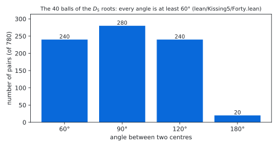
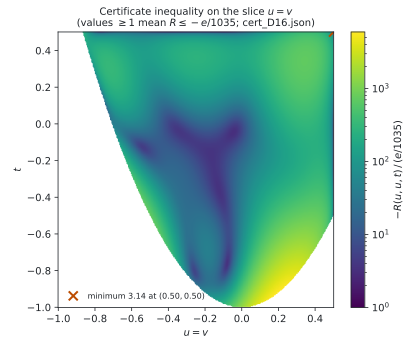
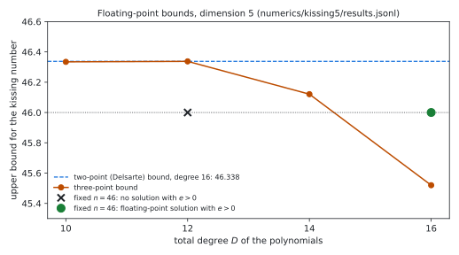

# Bounds for the kissing number in dimension 5: a Lean 4 formalisation of 40 ≤ κ(5) ≤ 45

Status: **Lean 4 formalisation, not peer reviewed.** Prepared 2026-11-11. **Produced by AI models** under the direction
of the repository owner; see [`AI_DISCLOSURE.md`](AI_DISCLOSURE.md).

> [!IMPORTANT]
> This repository is a public, timestamped, AI-produced **warrant** for a Lean 4 proof that the kissing number in
> dimension 5 is at least 40 and at most 45: a machine-checked argument that no human has yet digested. Both bounds
> are known results. The best published upper bound is 44 (Mittelmann and Vallentin, 2010), so the upper bound here
> is **not** new; what this repository adds is a machine-checked proof of a bound of this kind. We do not regard
> this formal argument as settled until it has been checked independently.
> Independent verification and human-readable expositions are welcome, and credit for a human-readable proof belongs
> to whoever writes one. Questions, checks and corrections:
> [GitHub issues](https://github.com/alejandrozarco/kissing-number-5/issues).

Cite with `CITATION.cff`.

The kissing number $`\kappa(d)`$ is the largest number of non-overlapping unit balls in $`\mathbb{R}^d`$ that touch a
common unit ball. Its value in dimension 5 is not known. `lean/Kissing5/Statement.lean` states, and the Lean kernel
checks in `lean/Kissing5/Solution.lean`:

```math
40 \le \kappa(5) \le 45 .
```

The lower bound uses the 40 roots of $`D_5`$, with integer coordinates. The upper bound uses an exact three-point
semidefinite certificate in the sense of Bachoc and Vallentin for 46 points, checked by `decide +kernel`. It also
uses a Lean proof of the Bachoc–Vallentin positivity theorem on the sphere $`S^4`$ for the degrees used.

## The statement

```lean
abbrev E (d : ℕ) := EuclideanSpace ℝ (Fin d)

def IsKissing {d : ℕ} (S : Set (E d)) : Prop :=
  (∀ x ∈ S, ‖x‖ = 2) ∧ ∀ x ∈ S, ∀ y ∈ S, x ≠ y → 2 ≤ dist x y

noncomputable def kissingNumber (d : ℕ) : ℕ∞ :=
  ⨆ (S : Set (E d)) (_ : IsKissing S), S.encard

theorem exists_isKissing_encard_eq_forty : ∃ S : Set (E 5), IsKissing S ∧ S.encard = 40
theorem encard_le_fortyFive_of_isKissing (S : Set (E 5)) (hS : IsKissing S) : S.encard ≤ 45
theorem kissingNumber_five_bounds : 40 ≤ kissingNumber 5 ∧ kissingNumber 5 ≤ 45
```

`IsKissing S` says that the points of `S` are centres of unit balls that touch the unit ball at the origin (distance
2) and do not overlap each other (pairwise distance at least 2). Sets may be infinite; sizes are counted in `ℕ∞`.
Three further theorems test the definition:
- two opposite balls form an arrangement;
- two balls $`30^\circ`$ apart do not;
- a ball at distance 3 does not.

The definitions are those of [kissing-number-3](https://github.com/alejandrozarco/kissing-number-3) and
[kissing-number-4](https://github.com/alejandrozarco/kissing-number-4) with $`d = 5`$.
[`lean/STATEMENT5.md`](lean/STATEMENT5.md) explains every line.

Checks recorded in [`verification/`](verification/):
- **Comparator:** the six theorems of `lean/comparator5.json` have the statements of `lean/Kissing5/Statement.lean`,
  use only the axioms `propext`, `Quot.sound`, `Classical.choice`, and are accepted by the Lean kernel.
- **Axioms:** `#print axioms` reports `[propext, Classical.choice, Quot.sound]` for all six.
- **Second kernel:** the export of the six theorems is accepted by nanoda, an independent type checker for Lean 4
  written in Rust. A copy with one changed number is rejected.
- **Clean build:** the modules the proof uses, compiled one at a time from a fresh copy, with wall time and peak
  memory (table below).

The files contain no `sorry` outside the `Statement.lean` files and no `native_decide`.

## The argument

Any arrangement with more than 45 balls contains 46. Halving their centres gives unit vectors
$`x_1, \dots, x_{46}`$ in $`\mathbb{R}^5`$ with $`\langle x_i, x_j \rangle \le 1/2`$ for $`i \ne j`$. For three unit
vectors write $`(u, v, t)`$ for their pairwise inner products, and let $`\Delta`$ be the set of such triples with
$`u, v, t \le 1/2`$. The certificate consists of positive definite matrices $`F_0, \dots, F_8`$ of sizes 9 to 1. With
the Bachoc–Vallentin matrices $`S_k`$ of $`S^4`$ and

```math
s(u,v,t) = \sum_{k=0}^{8} \langle F_k, S_k(u,v,t) \rangle ,
\qquad
R(u,v,t) = 44\, s(u,v,t) + s(u,u,1) + s(v,v,1) + s(t,t,1) + \frac{1}{45}\, s(1,1,1),
```

it contains a sum-of-squares identity showing

```math
R(u,v,t) \le -\frac{1}{32 \cdot 1035} \quad \text{on } \Delta .
```

Summing over all ordered triples of distinct points and using the positivity of $`\sum_{i,j,l} S_k`$ gives
$`1/32 \le 0`$, a contradiction. The polynomials have total degree 16. The sum-of-squares part uses the multipliers
$`1`$, $`1/2-u`$, $`1/2-v`$, $`1/2-t`$ and the Gram determinant $`1 + 2uvt - u^2 - v^2 - t^2`$. Their Gram matrices
have sizes 165, 120 (three times) and 84. All entries are rationals with a common denominator.

The positivity of $`\sum_{i,j,l} S_k(\langle x_i,x_j\rangle, \langle x_i,x_l\rangle, \langle x_j,x_l\rangle)`$ for
unit vectors of $`\mathbb{R}^5`$ is proved in `lean/Kissing5/Positivity.lean` for $`k \le 8`$. In an orthonormal
frame of the complement of $`x_i`$, the kernel becomes the solid Gegenbauer kernel of $`\mathbb{R}^4`$. That kernel is
positive semidefinite by induction on the dimension from $`\mathbb{R}^2`$ (`lean/Kissing5/Psd.lean`). The induction
uses one addition identity per degree and dimension (`lean/Kissing5/Addition*.lean`, generated by
`lean/gen/gen_addition5.py`).

| Lean module | content |
|---|---|
| `Kissing5/Kernel.lean` | the kernels of $`S^4`$, the Gram determinant in $`\mathbb{R}^5`$, the three-point identity |
| `Kissing5/Addition*.lean`, `Kissing5/Psd.lean` | addition identities and positive semidefiniteness of the Gegenbauer kernels of $`\mathbb{R}^3`$ and $`\mathbb{R}^4`$, degrees 0 to 8 |
| `Kissing5/Positivity.lean` | Bachoc–Vallentin positivity on $`S^4`$, degrees 0 to 8 |
| `Kissing5/Bound.lean` | the three-point bound in $`\mathbb{R}^5`$, with the inner products restricted by an arbitrary condition |
| `Kissing5/CertK.lean` | the exact certificate checker for $`\Delta`$ and its soundness theorem |
| `Kissing5/Chunk.lean` | lemmas that split the kernel checks of large blocks into chunks of rows |
| `Kissing5/Cert/` | the certificate data and its `decide +kernel` checks (one module per $`F`$-block; 4 to 8 rows per module for the sum-of-squares blocks) |
| `Kissing5/Forty.lean` | the 40 points: integer coordinates scaled by $`\sqrt 2`$, norm exactly 2, pairwise distance at least 2 |
| `Kissing5/Solution.lean` | the statements of `Kissing5/Statement.lean`, with proofs |

`Kissing5` reuses code from earlier developments:
- the dimension-independent certificate format and checker of the dimension-3 development (`lean/Kissing/`,
  published as [kissing-number-3](https://github.com/alejandrozarco/kissing-number-3));
- the Gegenbauer kernels and the induction step of the dimension-8 development (`lean/Kissing8/Kernel.lean`, published
  as [kissing-number-8](https://github.com/alejandrozarco/kissing-number-8)).

The Lean package here also contains the dimension-3, -4 and -8 developments, which share its Lake configuration. Their
verification records are in their own repositories; `verification/` holds the records for `Kissing5`.

The certificate was found in floating point with a symmetry-reduced formulation (`numerics/kissing5/k5.py`,
`sym.py`). It was rounded to exact rationals (`numerics/kissing5/round_k5.py`). Before the Lean check, an independent
script checked it in exact arithmetic (`numerics/kissing5/check_cert_k5.py`). The same script rejects ten tampered
versions (`check_controls_k5.py`).

## Figures

Regenerate with `python3 figures/make_figures.py` (matplotlib 3.9.4, numpy); every figure is computed from repository
files only.

<picture>
  <source media="(prefers-color-scheme: dark)" srcset="figures/angles_dark.svg">
  
</picture>

The 780 angles between the 40 centres of the lower bound (`lean/Kissing5/Forty.lean`), seen from the origin.
Two balls touching the central ball overlap exactly when their angle is below $`60^\circ`$; here 240 pairs touch.

<picture>
  <source media="(prefers-color-scheme: dark)" srcset="figures/certificate_dark.svg">
  
</picture>

The certificate inequality $`R \le -e/1035`$ with $`e = 1/32`$, evaluated in floating point from `cert_D16.json` on
the slice $`u = v`$ of the region $`\Delta`$ (white: triples that are not inner products of unit vectors). The Lean
check covers all of $`\Delta`$ exactly.

<picture>
  <source media="(prefers-color-scheme: dark)" srcset="figures/bounds_dark.svg">
  
</picture>

Floating-point values from `numerics/kissing5/results.jsonl` (not certified):
- the two-point (Delsarte) bound is 46.338;
- the three-point bound computed here drops below 46 only at degree 16 (45.52);
- the fixed-$`n`$ problem for $`n = 46`$ has no solution with positive margin at degree 12 and has one at degree 16.

The certificate is the rounded degree-16 solution.

## Contents

| path | content |
|---|---|
| `lean/` | the Lean package: statement, proof, certificate modules, emitters (`gen/`), `regen.sh`, Comparator configs, build and second-kernel scripts |
| `lean/STATEMENT5.md` | the statement in plain English |
| `numerics/kissing5/` | SDP formulation for $`S^4`$ with its symmetry reduction, floating-point solutions, exact rounding, exact checker, the certificate `cert_D16.json` |
| `numerics/kissing3/` | the dimension-3 code that `numerics/kissing5/` builds on (from kissing-number-3) |
| `verification/` | records of the clean build, Comparator, axioms, the second kernel and the upstream-text scan |
| `figures/` | the figures and `make_figures.py` |
| `formalization.yaml` | metadata (mathlib-initiative format v0.4) |
| `AI_DISCLOSURE.md` | how AI models were used, what is checked and what is trusted |
| `LICENSE`, `CITATION.cff` | licence (Apache-2.0) and citation metadata |
| `MANIFEST.sha256` | sha256 of every file |

## Reproduce

Lean (toolchain `leanprover/lean4:v4.34.1`, Mathlib `d13f23b`, both pinned):

```sh
cd lean
./regen.sh                    # regenerates ThomsonGen/*.lean from upstream; checks the eight imported ones by sha256
lake exe cache get
bash scripts/build_test.sh build_test5.tsv "Kissing5.Statement Kissing5.Solution Kissing5.Axioms"
lake env lean Kissing5/Axioms.lean
```

`build_test.sh` compiles every module one at a time. The largest module (an upstream-derived one) needs about
8.6 GiB, and the certificate modules need up to 8.3 GiB each. `lake build Kissing5` also works but may compile several modules in parallel;
the modules form one import chain to limit this.
- `lean/scripts/run_comparator.sh comparator5.json` runs [Comparator](https://github.com/leanprover/comparator).
- `lean/scripts/second-kernel.sh comparator5.json` runs [nanoda](https://github.com/ammkrn/nanoda_lib) and the
  negative control.

Without prebuilt tools, both scripts fetch and build them at the revisions pinned in `lean/scripts/tools.sh`. That
file also records the sha256 of the binaries used for `verification/`.

Certificate (Python 3, `python-flint`, `numpy`; `cvxpy` with Clarabel and `scipy` only to re-solve; `sympy` only for
`gen_addition5.py`):

```sh
cd numerics/kissing5
python3 check_cert_k5.py cert_D16.json                                          # exact check
python3 check_controls_k5.py cert_D16.json                                      # tampered certificates must be rejected
python3 round_k5.py sol/fixn_D16_n46_mu0.5_sym_mlin2.npz cert.json 40           # re-round the float solution (about 20 min)
python3 ../../lean/gen/emit_k5.py cert_D16.json --outdir /tmp/Cert              # re-emit the Lean data
SYM=1 MULTS=lin2 ./run.sh fixn 16 46 && SYM=1 MULTS=lin2 ./run.sh mu 16 46 0.5  # re-solve (float; about 3 min, 1.3 GB)
```

## Clean build

The 170 modules reachable from the build roots `Kissing5.Statement`, `Kissing5.Solution` and
`Kissing5.Axioms`, each compiled one at a time (`lean/scripts/build_test.sh`, `lean -j1`) from a fresh copy of
`lean/` after `regen.sh` and `lake exe cache get`, on Linux x86_64 (`verification/build_test5.tsv`). Wall time
includes loading Mathlib for each module. Memory in GiB ($`2^{30}`$ bytes).

Total 3.4 h; largest peak 8.60 GiB (`ThomsonGen.M2`).

<details><summary>Per-module table</summary>

| module | wall (s) | peak RSS (GiB) |
|---|---:|---:|
| `Kissing5.Statement` | 269 | 6.38 |
| `ThomsonGen.Preamble` | 37 | 6.50 |
| `ThomsonGen.ThreePoint` | 33 | 6.54 |
| `ThomsonGen.Kron` | 21 | 6.50 |
| `ThomsonGen.Cert1` | 17 | 6.49 |
| `ThomsonGen.Cert3` | 27 | 6.52 |
| `ThomsonGen.Case1Stat` | 16 | 6.46 |
| `ThomsonGen.M2` | 70 | 8.60 |
| `ThomsonGen.CertF` | 22 | 6.48 |
| `Kissing.Bound` | 15 | 6.46 |
| `Kissing.CertK` | 19 | 6.49 |
| `Kissing5.Kernel` | 29 | 6.60 |
| `Kissing8.Kernel` | 18 | 6.47 |
| `Kissing5.Addition3` | 32 | 6.57 |
| `Kissing5.Addition3_7` | 30 | 6.56 |
| `Kissing5.Addition3_8` | 30 | 6.61 |
| `Kissing5.Addition4` | 33 | 6.57 |
| `Kissing5.Addition4_7` | 26 | 6.57 |
| `Kissing5.Addition4_8` | 32 | 6.61 |
| `Kissing5.Psd` | 15 | 6.46 |
| `Kissing5.Positivity` | 20 | 6.48 |
| `Kissing5.Bound` | 17 | 6.47 |
| `Kissing5.CertK` | 17 | 6.50 |
| `Kissing5.Chunk` | 15 | 6.47 |
| `Kissing5.Cert.Data` | 49 | 6.65 |
| `Kissing5.Cert.ChkF0` | 37 | 6.92 |
| `Kissing5.Cert.ChkF1` | 33 | 6.82 |
| `Kissing5.Cert.ChkF2` | 34 | 6.72 |
| `Kissing5.Cert.ChkF3` | 36 | 6.68 |
| `Kissing5.Cert.ChkF4` | 32 | 6.61 |
| `Kissing5.Cert.ChkF5` | 31 | 6.58 |
| `Kissing5.Cert.ChkF6` | 33 | 6.55 |
| `Kissing5.Cert.ChkF7` | 30 | 6.52 |
| `Kissing5.Cert.ChkF8` | 30 | 6.50 |
| `Kissing5.Cert.ChkS0_0` | 64 | 7.23 |
| `Kissing5.Cert.ChkS0_1` | 96 | 7.30 |
| `Kissing5.Cert.ChkS0_2` | 101 | 7.30 |
| `Kissing5.Cert.ChkS0_3` | 86 | 7.33 |
| `Kissing5.Cert.ChkS0_4` | 88 | 7.34 |
| `Kissing5.Cert.ChkS0_5` | 90 | 7.40 |
| `Kissing5.Cert.ChkS0_6` | 83 | 7.40 |
| `Kissing5.Cert.ChkS0_7` | 93 | 7.43 |
| `Kissing5.Cert.ChkS0_8` | 91 | 7.46 |
| `Kissing5.Cert.ChkS0_9` | 93 | 7.48 |
| `Kissing5.Cert.ChkS0_10` | 89 | 7.50 |
| `Kissing5.Cert.ChkS0_11` | 92 | 7.53 |
| `Kissing5.Cert.ChkS0_12` | 104 | 7.59 |
| `Kissing5.Cert.ChkS0_13` | 105 | 7.58 |
| `Kissing5.Cert.ChkS0_14` | 103 | 7.66 |
| `Kissing5.Cert.ChkS0_15` | 102 | 7.65 |
| `Kissing5.Cert.ChkS0_16` | 113 | 7.69 |
| `Kissing5.Cert.ChkS0_17` | 110 | 7.71 |
| `Kissing5.Cert.ChkS0_18` | 114 | 7.73 |
| `Kissing5.Cert.ChkS0_19` | 105 | 7.77 |
| `Kissing5.Cert.ChkS0_20` | 117 | 7.79 |
| `Kissing5.Cert.ChkS0_21` | 129 | 7.84 |
| `Kissing5.Cert.ChkS0_22` | 117 | 7.85 |
| `Kissing5.Cert.ChkS0_23` | 128 | 7.88 |
| `Kissing5.Cert.ChkS0_24` | 126 | 7.90 |
| `Kissing5.Cert.ChkS0_25` | 132 | 7.93 |
| `Kissing5.Cert.ChkS0_26` | 135 | 7.94 |
| `Kissing5.Cert.ChkS0_27` | 139 | 7.97 |
| `Kissing5.Cert.ChkS0_28` | 151 | 8.02 |
| `Kissing5.Cert.ChkS0_29` | 151 | 8.04 |
| `Kissing5.Cert.ChkS0_30` | 154 | 8.06 |
| `Kissing5.Cert.ChkS0_31` | 149 | 8.08 |
| `Kissing5.Cert.ChkS0_32` | 166 | 8.10 |
| `Kissing5.Cert.ChkS0_33` | 166 | 8.14 |
| `Kissing5.Cert.ChkS0_34` | 168 | 8.17 |
| `Kissing5.Cert.ChkS0_35` | 174 | 8.19 |
| `Kissing5.Cert.ChkS0_36` | 174 | 8.21 |
| `Kissing5.Cert.ChkS0_37` | 177 | 8.25 |
| `Kissing5.Cert.ChkS0_38` | 190 | 8.26 |
| `Kissing5.Cert.ChkS0_39` | 199 | 8.30 |
| `Kissing5.Cert.ChkS0_40` | 204 | 8.31 |
| `Kissing5.Cert.ChkS0_41` | 80 | 7.16 |
| `Kissing5.Cert.ChkS0` | 34 | 6.51 |
| `Kissing5.Cert.ChkS1_0` | 54 | 6.98 |
| `Kissing5.Cert.ChkS1_1` | 74 | 7.04 |
| `Kissing5.Cert.ChkS1_2` | 66 | 7.08 |
| `Kissing5.Cert.ChkS1_3` | 64 | 7.10 |
| `Kissing5.Cert.ChkS1_4` | 67 | 7.13 |
| `Kissing5.Cert.ChkS1_5` | 69 | 7.16 |
| `Kissing5.Cert.ChkS1_6` | 62 | 7.17 |
| `Kissing5.Cert.ChkS1_7` | 63 | 7.21 |
| `Kissing5.Cert.ChkS1_8` | 66 | 7.25 |
| `Kissing5.Cert.ChkS1_9` | 69 | 7.28 |
| `Kissing5.Cert.ChkS1_10` | 65 | 7.30 |
| `Kissing5.Cert.ChkS1_11` | 64 | 7.33 |
| `Kissing5.Cert.ChkS1_12` | 64 | 7.35 |
| `Kissing5.Cert.ChkS1_13` | 68 | 7.38 |
| `Kissing5.Cert.ChkS1_14` | 66 | 7.40 |
| `Kissing5.Cert.ChkS1_15` | 68 | 7.42 |
| `Kissing5.Cert.ChkS1_16` | 65 | 7.47 |
| `Kissing5.Cert.ChkS1_17` | 73 | 7.51 |
| `Kissing5.Cert.ChkS1_18` | 71 | 7.53 |
| `Kissing5.Cert.ChkS1_19` | 71 | 7.56 |
| `Kissing5.Cert.ChkS1_20` | 81 | 7.59 |
| `Kissing5.Cert.ChkS1_21` | 72 | 7.61 |
| `Kissing5.Cert.ChkS1_22` | 73 | 7.66 |
| `Kissing5.Cert.ChkS1_23` | 74 | 7.68 |
| `Kissing5.Cert.ChkS1` | 29 | 6.50 |
| `Kissing5.Cert.ChkS2_0` | 54 | 7.00 |
| `Kissing5.Cert.ChkS2_1` | 73 | 7.04 |
| `Kissing5.Cert.ChkS2_2` | 66 | 7.08 |
| `Kissing5.Cert.ChkS2_3` | 64 | 7.08 |
| `Kissing5.Cert.ChkS2_4` | 64 | 7.13 |
| `Kissing5.Cert.ChkS2_5` | 67 | 7.16 |
| `Kissing5.Cert.ChkS2_6` | 67 | 7.18 |
| `Kissing5.Cert.ChkS2_7` | 62 | 7.21 |
| `Kissing5.Cert.ChkS2_8` | 70 | 7.25 |
| `Kissing5.Cert.ChkS2_9` | 66 | 7.28 |
| `Kissing5.Cert.ChkS2_10` | 69 | 7.30 |
| `Kissing5.Cert.ChkS2_11` | 64 | 7.32 |
| `Kissing5.Cert.ChkS2_12` | 63 | 7.35 |
| `Kissing5.Cert.ChkS2_13` | 68 | 7.40 |
| `Kissing5.Cert.ChkS2_14` | 68 | 7.42 |
| `Kissing5.Cert.ChkS2_15` | 68 | 7.43 |
| `Kissing5.Cert.ChkS2_16` | 67 | 7.46 |
| `Kissing5.Cert.ChkS2_17` | 72 | 7.49 |
| `Kissing5.Cert.ChkS2_18` | 68 | 7.53 |
| `Kissing5.Cert.ChkS2_19` | 72 | 7.56 |
| `Kissing5.Cert.ChkS2_20` | 70 | 7.59 |
| `Kissing5.Cert.ChkS2_21` | 70 | 7.62 |
| `Kissing5.Cert.ChkS2_22` | 69 | 7.66 |
| `Kissing5.Cert.ChkS2_23` | 76 | 7.68 |
| `Kissing5.Cert.ChkS2` | 30 | 6.50 |
| `Kissing5.Cert.ChkS3_0` | 58 | 6.98 |
| `Kissing5.Cert.ChkS3_1` | 74 | 7.05 |
| `Kissing5.Cert.ChkS3_2` | 68 | 7.08 |
| `Kissing5.Cert.ChkS3_3` | 63 | 7.08 |
| `Kissing5.Cert.ChkS3_4` | 64 | 7.13 |
| `Kissing5.Cert.ChkS3_5` | 63 | 7.16 |
| `Kissing5.Cert.ChkS3_6` | 65 | 7.18 |
| `Kissing5.Cert.ChkS3_7` | 66 | 7.21 |
| `Kissing5.Cert.ChkS3_8` | 68 | 7.26 |
| `Kissing5.Cert.ChkS3_9` | 62 | 7.29 |
| `Kissing5.Cert.ChkS3_10` | 70 | 7.31 |
| `Kissing5.Cert.ChkS3_11` | 69 | 7.33 |
| `Kissing5.Cert.ChkS3_12` | 63 | 7.35 |
| `Kissing5.Cert.ChkS3_13` | 71 | 7.39 |
| `Kissing5.Cert.ChkS3_14` | 72 | 7.40 |
| `Kissing5.Cert.ChkS3_15` | 64 | 7.44 |
| `Kissing5.Cert.ChkS3_16` | 63 | 7.47 |
| `Kissing5.Cert.ChkS3_17` | 70 | 7.51 |
| `Kissing5.Cert.ChkS3_18` | 69 | 7.53 |
| `Kissing5.Cert.ChkS3_19` | 68 | 7.56 |
| `Kissing5.Cert.ChkS3_20` | 77 | 7.60 |
| `Kissing5.Cert.ChkS3_21` | 67 | 7.62 |
| `Kissing5.Cert.ChkS3_22` | 72 | 7.66 |
| `Kissing5.Cert.ChkS3_23` | 73 | 7.68 |
| `Kissing5.Cert.ChkS3` | 30 | 6.50 |
| `Kissing5.Cert.ChkS4_0` | 60 | 6.92 |
| `Kissing5.Cert.ChkS4_1` | 63 | 6.97 |
| `Kissing5.Cert.ChkS4_2` | 65 | 6.99 |
| `Kissing5.Cert.ChkS4_3` | 59 | 7.04 |
| `Kissing5.Cert.ChkS4_4` | 64 | 7.12 |
| `Kissing5.Cert.ChkS4_5` | 65 | 7.14 |
| `Kissing5.Cert.ChkS4_6` | 70 | 7.19 |
| `Kissing5.Cert.ChkS4_7` | 69 | 7.25 |
| `Kissing5.Cert.ChkS4_8` | 72 | 7.29 |
| `Kissing5.Cert.ChkS4_9` | 80 | 7.32 |
| `Kissing5.Cert.ChkS4_10` | 46 | 6.95 |
| `Kissing5.Cert.ChkS4` | 26 | 6.50 |
| `Kissing5.Cert.ChkId` | 14 | 6.49 |
| `Kissing5.Cert.OkF` | 14 | 6.51 |
| `Kissing5.Cert.Check` | 15 | 6.49 |
| `Kissing5.Forty` | 21 | 6.67 |
| `Kissing5.Solution` | 18 | 6.51 |
| `Kissing5.Axioms` | 15 | 6.46 |

</details>

## Upstream code and related work

- **Coulomb Thomson problem (upstream).** The three-point machinery (the three-point identity, the integer
  certificate format with the Kronecker check) is from the Lean formalisation of the Coulomb Thomson problem,
  [huwngtran/thomson-n7-lean](https://github.com/huwngtran/thomson-n7-lean) at commit `25f2fa5`.
  - That repository has no licence file, so its code is not stored here. `lean/regen.sh` downloads the pinned file,
    regenerates the upstream-derived `ThomsonGen/` modules, and checks the eight that are imported against
    `lean/ThomsonGen/scripts/generated.sha256`.
  - Declarations adapted from it name their upstream source in a comment after the imports.
    `lean/ThomsonGen/scripts/scan_upstream.py` checks this (`verification/scan_upstream.txt`).
  - Upstream proves Bachoc–Vallentin positivity on $`S^2`$; the $`S^4`$ version here is new code following the same
    plan.
- **Our own tools.** The splitter `split.py`, the scanner, `lean/gen/cert3_util.py`, `numerics/kissing3/polyk.py` and
  the second-kernel script are adapted from [alejandrozarco/thomson-n7-log](https://github.com/alejandrozarco/thomson-n7-log).
- **Literature.**
  - C. Bachoc and F. Vallentin, *New upper bounds for kissing numbers from semidefinite programming*, J. Amer. Math.
    Soc. 21 (2008), 909–924: the three-point method and the bound $`\kappa(5) \le 45`$.
  - H. D. Mittelmann and F. Vallentin, *High-accuracy semidefinite programming bounds for kissing numbers*,
    Experiment. Math. 19 (2010): $`\kappa(5) \le 44`$, from a high-precision floating-point computation.
  - A. M. Odlyzko and N. J. A. Sloane, *New bounds on the number of unit spheres that can touch a unit sphere in n
    dimensions*, J. Combin. Theory Ser. A 26 (1979): the linear programming bound 46.
- **Related formal and exact work.** Found on 2026-10-02 and 2026-11-11:
  - lattice kissing numbers in Lean (TauCetiProject/TauCeti);
  - asymptotic bounds in Lean (Vilin97/lean-pool);
  - an exact rational three-point certificate for dimension 11, checked in Julia and Python
    (ruturajr-raval/kissing-number-11-certified-upper-bound);
  - the formalisations [kissing-number-3](https://github.com/alejandrozarco/kissing-number-3),
    [kissing-number-4](https://github.com/alejandrozarco/kissing-number-4) and
    [kissing-number-8](https://github.com/alejandrozarco/kissing-number-8).

  We did not find a formal proof of either bound in dimension 5, nor an exact certificate for
  $`\kappa(5) \le 45`$ or $`\kappa(5) \le 44`$; please tell us if one exists.

## Licence

Apache License 2.0 ([`LICENSE`](LICENSE)), copyright 2026 the repository owner (alejandrozarco). Not covered:
- the upstream modules that `lean/regen.sh` regenerates (not stored here);
- the upstream material in the adapted declarations named in the files;
- the upstream material in `lean/scripts/run_comparator.sh` and `lean/scripts/tools.sh`.
